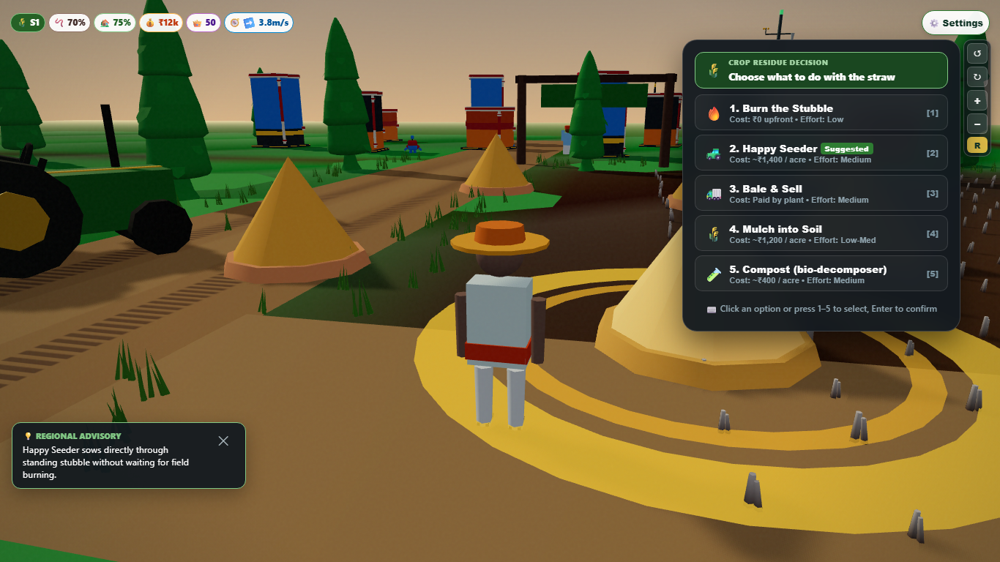
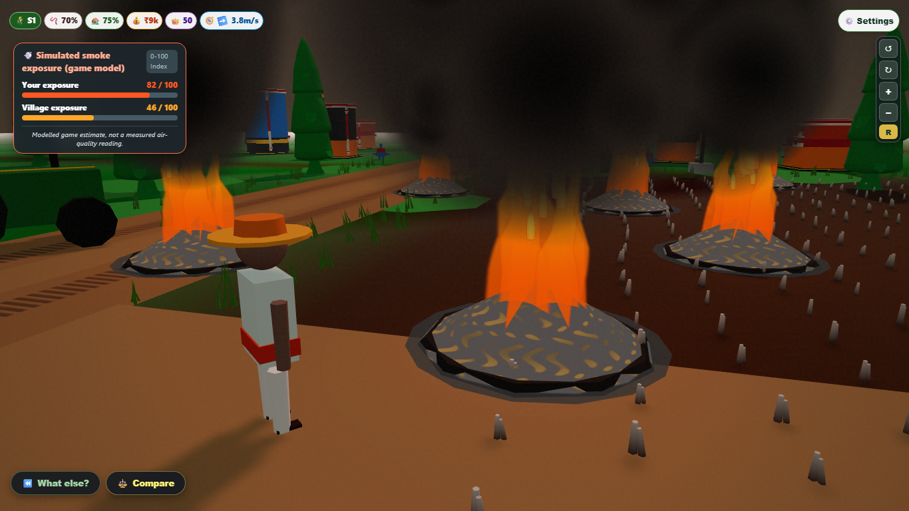
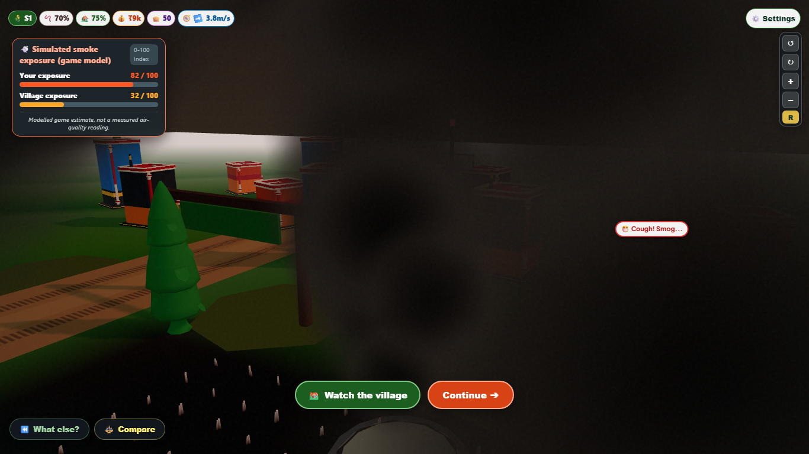
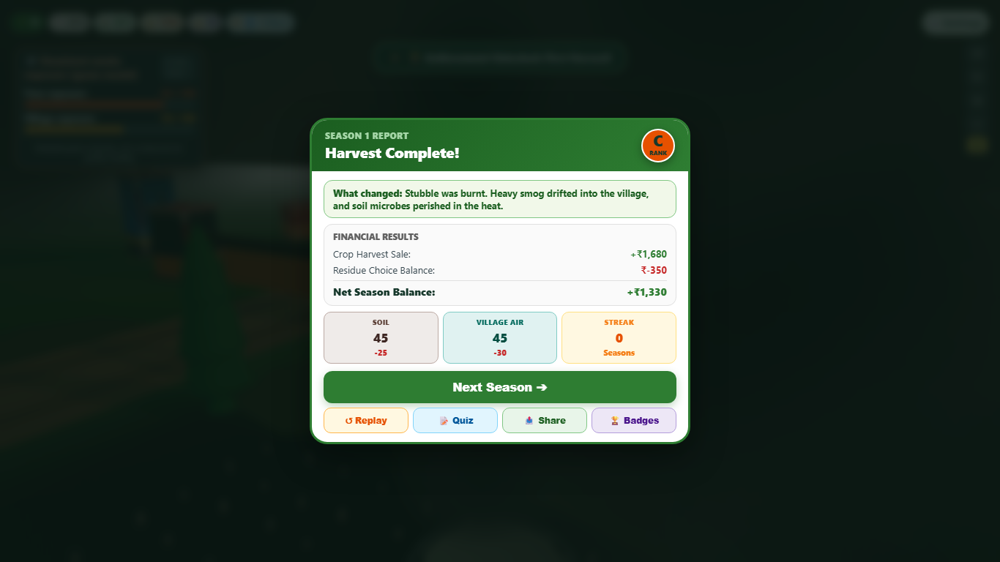
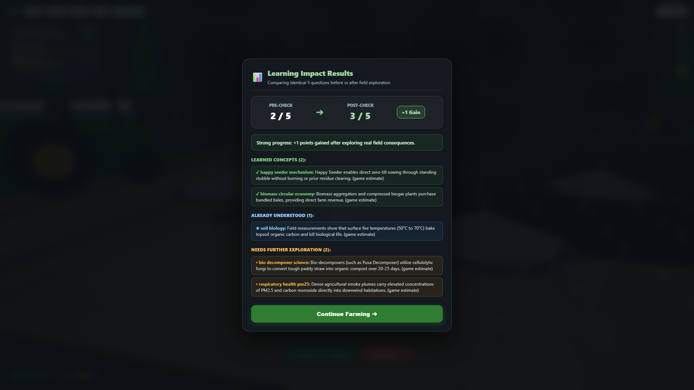
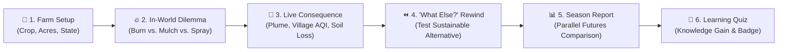

# What Else Sustain 🌾🚜

**An immersive 3D experiential web simulation that bridges agricultural reality, environmental science, and sustainable choices.**

> *"Make the mistake. Understand it. Choose what else."*  
> *"తప్పు చేయండి. తెలుసుకోండి. ప్రత్యామ్నాయాన్ని ఎంచుకోండి."*  
> *"गलती करें। समझें। सही विकल्प चुनें।"*

[](https://what-else-sustain.onrender.com/)
[](https://react.dev/)
[](https://threejs.org/)
[](https://fastapi.tiangolo.com/)
[](LICENSE)

🔗 **Live Simulation**: [https://what-else-sustain.onrender.com/](https://what-else-sustain.onrender.com/)  
👨‍🏫 **Teacher & Facilitator Guide**: [docs/TEACHER_GUIDE.md](docs/TEACHER_GUIDE.md)  
📊 **Scientific Sources & Methodology**: [SOURCES.md](SOURCES.md)

---

## 🎯 Purpose: Why What Else Sustain Exists

Every autumn across Northern and Central India, thousands of square kilometers of skies turn into hazardous smog. The public discourse often blames farmers for burning crop residue (*parali*). However, survey evidence and agricultural field studies reveal a critical truth: **farmers do not burn out of disregard for nature—they burn because they are trapped by acute operational constraints and lack accessible, timely alternatives.**

### The Real-World Dilemma
1. **The 15–20 Day Window**: Between harvesting paddy (rice) in October and sowing rabi wheat in November, farmers have less than three weeks to clear millions of tons of heavy, silica-rich straw. Delaying wheat sowing by even one week reduces yield by 150–200 kg per acre.
2. **The Cost of Manual Clearance**: Manual labor or hiring specialized machinery can cost ₹2,000 to ₹3,500 per acre—money smallholder farmers often do not have on hand before the harvest sells. A single matchstick costs ₹1.
3. **The Invisible Damage**: While smoke in the sky is visible, the most devastating long-term cost is underground: residue fires reach 400°C–600°C at ground level, scorching beneficial soil microbial flora, evaporating valuable soil organic carbon (SOC), and vaporizing nitrogen, phosphorus, and potassium that must later be replaced with expensive chemical fertilizers.

### The Educational Mission
Traditional awareness campaigns fail because they are preachy, one-directional, and abstract. **What Else Sustain** changes the paradigm:

- **The World is the Interface**: Instead of multiple-choice text quizzes, the player stands inside a 3D village and farm.
- **Experience the Mistake First**: Players are given the freedom to choose burning. They witness the fire ignite, watch a real-time Gaussian smoke plume engulf the nearby village, see villagers cough, watch the soil microbiome die in a cross-sectional soil cutaway, and see the immediate economic loss.
- **Discover Practical "What Else?" Options**: Players then rewind time to choose viable, scientifically proven alternatives (such as *Happy Seeder in-situ mulching*, *bio-decomposer spray*, or *ex-situ baling* for bio-energy), comparing real economic costs against soil yield benefits.
- **Empower Students & Future Leaders**: By cultivating empathy for agrarian pressures alongside scientific understanding, students and community members become proactive advocates for sustainable agricultural technology.

---

## 📸 In-Simulation Visuals

| 1. The Decision Point in 3D | 2. Live Burn & Downwind Smoke Plume |
| :---: | :---: |
|  |  |
| *Standing in the field: choosing residue management options directly in the world.* | *Dynamic fire tongues ignite with realistic downwind Gaussian smoke propagation.* |

| 3. "Watch the Village" Impact | 4. Season Comparison & Parallel Futures |
| :---: | :---: |
|  |  |
| *Cinematic village view: see the plume reach homes and observe AQI spike.* | *Honest comparison of costs, soil fertility saved, and air emissions avoided.* |

| 5. Pre/Post Knowledge Gain Assessment |
| :---: |
|  |
| *5-question comparable quiz measuring real learning gains and belief shifts.* |

---

## 🕹️ The Core Gameplay Loop



1. **Step into the Farm**: Start on a 25-acre farm in Punjab or Haryana with leftover paddy straw. Explore in third-person view with joystick or keyboard controls.
2. **Make the In-World Choice**: Approach the residue pile and choose between burning or sustainable practices.
3. **Witness the Consequence**:
   - **If Burning**: Dynamic flames flicker around the pile, and an interactive atmospheric smoke plume drifts downwind toward the 10 clustered village houses.
   - **Village Air Station**: Monitor live PM2.5 and AQI readings spike into "Severe / Hazardous" zones.
   - **Soil Cross-Section**: Inspect the soil core plaque to see underground organic carbon and micro-organisms get wiped out.
4. **The "What Else?" Rewind**: Use the rewind feature to return to the moment of decision without penalty and deploy a sustainable practice:
   - **Happy Seeder / Super Seeder (Mulching)**: Retains soil moisture, prevents weed emergence, and enriches organic carbon for wheat sowing.
   - **Bio-Decomposer Spray**: Microbially digests residue into natural compost within 20–25 days.
   - **Baler & Biomass Collection**: Bales straw for industrial bio-pellets, cardboard manufacturing, and power generation.
5. **Parallel Futures Report**: Compare the economic balance, soil health index, community health risk, and carbon footprint across both paths.
6. **Pre/Post Learning Assessment**: A balanced 5-question pre/post quiz evaluates knowledge retention with honest, supportive feedback.

---

## 🌟 Key Features

### 🎮 Immersive 3D Engine (Three.js & React Three Fiber)
- **Instanced Stalks & Procedural Terrain**: Renders dense crop fields and natural rural terrain efficiently using GPU instancing.
- **Dynamic Fire & Smoke Physics**: Realistic fire geometry with orange cores, yellow tips, ground firelight, and a physically modeled Gaussian smoke plume responsive to wind direction.
- **Cinematic Camera Choreography**: Smooth orbital transitions between farm exploration, third-person walking, and downwind "Watch the Village" collision-free camera angles.
- **Universal Multi-Tier Scalability**: Three quality tiers (High, Medium, Low) ensure smooth 60 FPS performance from budget 360x640 mobile phones up to high-resolution desktop displays.

### 🧠 AI Scenario Director & Agricultural Advisor (Gemini API)
- **Scenario Director**: Generates localized, context-aware farm dilemmas tailored to specific crops, acreage, and Indian states.
- **In-Game AI Advisor**: Players can ask natural language questions in English, Telugu, or Hindi (e.g., *"How does Happy Seeder save irrigation water?"*).
- **Offline Knowledge Shield**: If the device is offline or API limits are reached, the advisor automatically falls back to curated, scientifically validated offline knowledge (`src/data/aiOfflineKnowledge.js`).
- **Strict Privacy & Cost Caps**: Enforces rate limiting (10–20 req/min), rolling hourly quotas, input length sanitization, and output validation.

### 🏫 Classroom & Teacher Mode
- **Zero-Friction Class Rooms**: Facilitators create a 6-character room code; students join instantly on their own devices without creating an account or providing email addresses.
- **Real-Time Telemetry Dashboard**: Live metrics showing student decisions, alternative adoption rates, and pre vs. post quiz score improvements.
- **Offline Telemetry Queue**: Student progress is queued locally during spotty school Wi-Fi and synced automatically when reconnected.
- **CSV Data Export**: Export anonymized classroom learning outcomes for academic assessments and impact reports.

### 🔬 Scientific Data Integrity
- **No Invented Numbers**: Every single numerical value shown in the game is cataloged in [`SOURCES.md`](SOURCES.md) with citations from ICAR, CPCB, PAU, or peer-reviewed literature.
- **Transparent Estimates**: Any unverified or modeled baseline figure is explicitly labeled with an in-game `"game estimate"` badge.

### 🔒 Privacy, Security & Student Safety
- **Audited Security**: Passed the rigorous 85-point Pre-Launch Security Audit (restricted CORS, strict static path traversal prevention, security headers, rate limiting).
- **Zero Personal Data Collected**: No user tracking, no third-party ad networks, no login credentials, and no cookies. Fully compliant with COPPA (under-13) and India's Digital Personal Data Protection (DPDP) Act.

---

## 🛠️ Technology Stack

```
Frontend:
  ├── React 19 (Hooks, Suspense, Error Boundaries)
  ├── Vite (Lightning-fast HMR and bundle optimization)
  ├── Three.js & @react-three/fiber & @react-three/drei (3D graphics)
  ├── Tailwind CSS & Lucide Icons (HUD, UI drawers, modals)
  └── Playwright (Multi-viewport E2E testing: 360x640 to 1920x1080)

Backend:
  ├── FastAPI (High-performance asynchronous Python web framework)
  ├── Pydantic v2 (Strict schema validation and sanitization)
  ├── SQLAlchemy (Async SQLite for local dev, PostgreSQL for production)
  ├── Google Gemini API (Contextual advisor & scenario generation)
  └── Pytest & pytest-asyncio (Comprehensive test suite)

Deployment:
  ├── Render (Unified single-service web service with static SPA serving)
  └── Docker (Multi-stage production container build)
```

---

## 🚀 Getting Started

### Prerequisites
- **Node.js**: v18.0.0 or higher
- **Python**: v3.11 or higher
- **Git**

### 1. Clone the Repository
```bash
git clone https://github.com/RupajiBalaji/What_else_sustain.git
cd What_else_sustain
```

### 2. Backend Setup
```bash
# Navigate to backend directory
cd backend

# Create and activate virtual environment
python -m venv .venv
# On Windows:
.\.venv\Scripts\Activate.ps1
# On macOS / Linux:
source .venv/bin/activate

# Install dependencies
pip install -r requirements.txt

# (Optional) Set up your Gemini API Key
cp .env.example .env
# Edit .env and insert your GEMINI_API_KEY from Google AI Studio

# Run backend tests
pytest tests

# Start FastAPI server
uvicorn app.main:app --host 0.0.0.0 --port 8000 --reload
```
The backend will be running at `http://localhost:8000`.

### 3. Frontend Setup
In a new terminal window:
```bash
# In the project root:
npm install

# Run linters and data integrity audit
npm run lint
npm test

# Start the Vite development server (proxies /api to localhost:8000)
npm run dev
```
Open **[http://localhost:5173](http://localhost:5173)** in your browser.

---

## 🧪 Testing & Verification

What Else Sustain adheres to a strict test-driven standard: **no feature is marked done without an automated test that can fail and a visual screenshot check.**

```bash
# 1. Run ESLint and data integrity audits
npm run lint

# 2. Run all frontend unit tests (state machine, quiz, translations, scaling)
npm test

# 3. Run backend unit & contract tests
python -m pytest backend/tests/

# 4. Run full Playwright End-to-End test suite across 6 viewports
npx playwright test
```

Tested Viewports:
- `360x640` (Budget Android mobile)
- `390x844` (Modern iPhone)
- `412x915` (Modern Android mobile)
- `768x1024` (Tablet portrait)
- `1366x768` (Standard laptop)
- `1920x1080` (Full HD desktop)

---

## 🌍 Multilingual Support

The simulation is fully localized across three primary languages:
- 🇬🇧 **English** (`en`)
- 🇮🇳 **తెలుగు / Telugu** (`te`)
- 🇮🇳 **हिन्दी / Hindi** (`hi`)

All 212 translation keys maintain 100% parity across languages, verified automatically via `scripts/audit_translations.js`.

---

## 👥 Project & Team

- **Founder & Project Lead**: Balaji Rupaji (Founder, Urvah Dynamics Pvt Ltd)
- **Repository**: [https://github.com/RupajiBalaji/What_else_sustain](https://github.com/RupajiBalaji/What_else_sustain)
- **Live Deployment**: [https://what-else-sustain.onrender.com/](https://what-else-sustain.onrender.com/)

---

## 📄 License

This project is licensed under the [MIT License](LICENSE).
